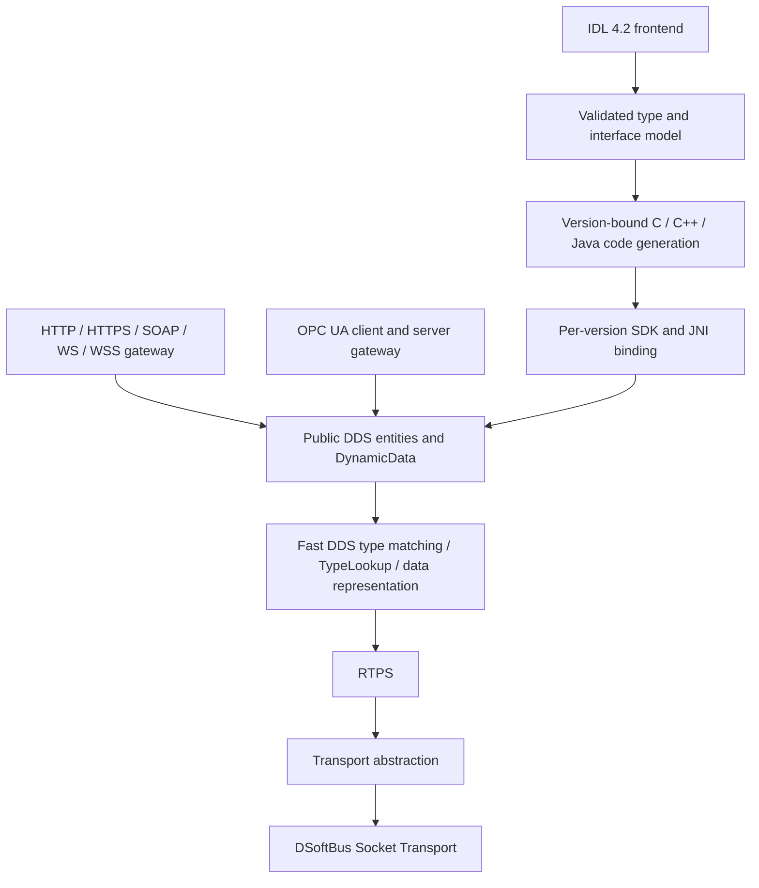

# DDS standards product architecture

Scope approved on 2026-11-10. Product releases target Fast DDS 2.14.5 and 3.6.2.
The applicable standards are [IDL 4.2](https://www.omg.org/spec/IDL/4.2/PDF),
[DDS-XTypes 1.3](https://www.omg.org/spec/DDS-XTypes/1.3/PDF),
[DDS-WEB 1.0](https://www.omg.org/spec/DDS-WEB/1.0/PDF), and
[DDS-OPCUA 1.0](https://www.omg.org/spec/DDS-OPCUA/1.0/PDF).

## Components

Each process loads one Fast DDS ABI and the corresponding generator output.
Original and patched releases have independent installation roots and build
identities. Dependencies, patch order, generated sources, and shared libraries
are identified by hashes. Fast DDS 3.2.5 receives existing-capability regression.

IDL language coverage includes all 15 building blocks and six annotation groups,
preprocessing, name resolution, and semantic diagnostics. The seven example
profiles in IDL section 9 provide combination tests. Middleware backends provide
their own language mappings and runtime tests. The DDS backend emits DDS types
and RPC support. C uses opaque handles and explicit ownership, C++ retains the
native public DDS entry points, and Java uses a per-ABI JNI library. Windows is
the Java runtime target. C/C++ and the gateways also target KaihongOS arm64.

XTypes Complete covers programming interfaces, Minimal and Basic network
interoperability, XTypes 1.1 interoperability, and XML Data Representation.
Type assignability, representation negotiation, serialization, and discovery
changes belong to versioned general-purpose Fast DDS/Fast CDR/generator patches.
DSoftBus transports RTPS bytes through the existing Socket transport.

The Web gateway owns the WebDDS object hierarchy, authorization, resource
lifetimes, read/write/wait operations, and notifications. Boost.Beast supplies
HTTP and WebSocket framing, OpenSSL supplies TLS, and libxml2 supplies XML/XSD.
The protocol contract follows the standard REST and SOAP mappings, including
the API key header, XML media types, and client notification endpoints. WS/WSS
receive distinct interoperability tests. SIMPLE-REST requires a documented
contract derived from OMG clarifications or an independently reproducible peer
implementation. Compatibility evidence and formal conformance evidence are
recorded separately for that mapping.

The OPC UA gateway uses open62541. UA-to-DDS creates UA client connections,
subscriptions, monitored items, and DDS data outputs. Complete adds the service
sets through DDS-RPC. DDS-to-UA exposes types, topics, keyed instances, and DDS
entity operations through UA nodes. Complete adds historical reads with an
explicit retention window. Independent UA implementations validate service
responses, Query operations, and historical reads. Each direction owns its
configuration, reconnect state, authorization, and shutdown sequence.

External callbacks enqueue bounded work. DDS loans and UA/XML buffers retain
their native ownership until copying or returning their loan. Configuration
declares domain, transport descriptor, endpoints, credentials, QoS, queue limits,
and retention. Unsupported QoS and conversion failures produce observable
errors. Credentials remain outside execution logs.

## Execution sequence and evidence

1. Reproduce the native UDP baseline for each version with independent writer
   and reader processes, including positive delivery and rejection controls.
2. Add reproducible IDL generation, compile generated sources, and prove the
   C/C++/Java mappings with real send/receive paths.
3. Implement and independently test XTypes patches by conformance profile.
   Run the same cases on UDP and real DSoftBus.
4. Implement Web protocol operations and notifications against independent
   clients, followed by the real dual-board DDS path.
5. Implement both OPC UA mappings through Basic and Complete, including RPC
   and historical reads, followed by real dual-board verification.

Each milestone follows IMPLEMENT, initial independent tester, agentic review,
review fixes, final independent tester, docs_updater, and pre-commit gate.
Each applicable requirement retains version, standard clause, test identity,
binary hashes, command, target, exit code, logs, and PASS/FAIL/BLOCKED status.

Windows tests exercise C/C++/Java. In device tests board A runs a native gateway
or DDS application, board B runs its DDS peer, and Windows supplies independent
Web/UA clients and servers. Device roles are reversed. Same-version and mixed
2.14.5/3.6.2 pairs are tested with only DSoftBus enabled between boards.

## Current implementation boundary

The current implementation adds an exact-version CMake entry, a public
DynamicData UDP probe using two processes, an evidence runner, a bounded
keyed IDL fixture with a hash/version-bound generation command, the B1
host-only IDL frontend core, and the B2 host-only IDL frontend/schema-2 model.
It also includes the A1 bounded 3.6.2
assignability patch and contracts. The generated C++ serialization roundtrip
builds for both 2.14.5 and 3.6.2. B1 does not deliver generated code or change
Fast DDS, Transport, or device communication.

It also delivers C1 as a finite, loopback-HTTP REST profile over public Fast
DDS APIs. C1 is HOST_TESTED and INTEGRATION_TESTED PASS on Fast DDS 2.14.5 and
3.6.2 with XCDR1 and XCDR2, including the bounded authorization, lifecycle,
read/wait, identity and timestamp contracts documented in
[`C1_DDS_WEB_REST.md`](C1_DDS_WEB_REST.md). The architecture diagram remains
aspirational for the full product: C2 notifications/WS/WSS, C3 SOAP and C4
native/DSoftBus gateway execution are not delivered by C1.

## AGENTS.md section 2.1: modifying RTPS endpoint matching

`patches/fastdds/2.14.5/0001-edp-honor-reader-type-consistency-qos.patch`
modifies `src/cpp/rtps/builtin/discovery/endpoint/EDP.cpp`. That is RTPS
endpoint discovery and matching, **not** the Transport layer. AGENTS.md
section 2.1 reserves that territory: two of its bullets are unqualified,
"不修改 DDS 层语义" and "不修改 RTPS 协议语义". The patch is therefore
admissible only through section 2.1's own exception, "除非有明确、经过论证且
得到用户批准的架构原因", which requires an explicit, argued and
**user-approved** architectural reason. The argument is recorded here so the
approval is not inferred from silence.

**Why no smaller change exists.** `EDP::checkTypeIdentifier` and
`EDP::checkTypeObject` construct a local `TypeConsistencyEnforcementQosPolicy`
fixed to `DISALLOW_TYPE_COERCION` and pass it to `consistent()` in place of
`rdata->m_qos.type_consistency`. The reader's policy is discarded before the
assignability algorithm ever sees it, so **no QoS setting at any layer, and no
change confined to the Transport, can reach the behaviour**. Upstream even
leaves the correct call present but commented out. This satisfies section
5.2(1): the current abstraction cannot express the required behaviour.

**Why this is not a DSoftBus workaround.** Section 2.1's other four bullets are
conditioned on accommodating DSoftBus ("以迁就 DSoftBus"). This patch is not:
the deliverable is UDP-only XTypes conformance, the change set touches no
DSoftBus API, and the patch is applied to upstream Fast DDS sources
out-of-tree at build time and ships no code into the Transport. The abstraction
diagram and the Socket-only rule in section 2.2 are untouched. This satisfies
section 5.2(3).

**Why other users are not broken.** Section 5.2(2) is discharged for the
shipped default and only partially for the opt-in. The gate defaults off, and
with it off the patched library reproduces stock 2.14.5 case for case on the
host and on both boards in both board directions. With it on, the relaxation is
per-process and wider than appendable/mutable assignability; that is disclosed
in full above rather than claimed away.

**Why this is a recorded and not a silent workaround.** Section 5.3 forbids a
silent workaround and permits a recorded one. The mechanism and the reason it
cannot simply be enabled are stated in the patch header; this document and
`BASELINE.md` name the variable and its blast radius; `build_fastdds_ohos.sh`
defaults `FASTDDS_PATCH_DIR` to empty and writes either `fastdds_patch none` or
the patch sha256 into `BUILD_INFO.txt`; and every `results.json` written by the current runner records `gate_variable`, `gate_value` and `gate_on` per run and per peer, at `schema_version: 2`. Many retained files predate the field; the three cited as the host three-way comparison, `build/prepatch-214/`, `build/patched-gate-off/` and `build/patched-gate-on/`, are `schema_version: 1` and carry none of those keys; see [`BASELINE.md`](BASELINE.md).

**Scope of the approval granted.** Not "patch Fast DDS as needed". The
2026-11-10 approval below remains limited to the one gated 2.14.5 endpoint
matching change. A separate user approval on 2026-11-11 covers only the
default-off, versioned 3.6.2 A1.0 bounded assignability patch documented in
[`A1_TYPE_ASSIGNABILITY.md`](A1_TYPE_ASSIGNABILITY.md). Neither approval is a
general licence for further Fast DDS changes.

| Item | State |
| --- | --- |
| Section 5.2(1) no smaller change exists | ARGUED above, from upstream source |
| Section 5.2(2) other users unaffected | PROVEN gate-off; DISCLOSED, not proven, gate-on |
| Section 5.2(3) not a DSoftBus workaround | PROVEN, no DSoftBus code touched |
| Section 5.3 recorded not silent | SATISFIED |
| Section 2.1 user approval for modifying RTPS | **APPROVED by the user on 2026-11-10** for this one gated change only |

The user approved this exception on 2026-11-10, for **this one gated change to
Fast DDS 2.14.5 endpoint matching, default off**, applied out-of-tree at build
time for the XTypes standards deliverable. The approval is not a general licence
to patch Fast DDS: any further change to DDS or RTPS semantics needs its own
argument and its own approval under section 2.1.

| Capability | Implementation | Execution evidence |
| --- | --- | --- |
| Exact-version UDP type probe | PRESENT | Host baseline executed for both versions |
| IDL generation and output hashes | PRESENT | Fast DDS-Gen 3.3.1/4.3.0 generation PASS |
| Generated keyed/bounded C++ roundtrip | PRESENT | 2.14.5 and 3.6.2 CTest 1/1 PASS |
| B1 IDL frontend core | PRESENT | HOST_TESTED PASS; review R1–R3 closed; see [`B1_IDL_FRONTEND.md`](B1_IDL_FRONTEND.md) and final tester evidence |
| B2 IDL building blocks, annotations and §9 profiles | PRESENT | HOST_TESTED PASS; review R1–R5/C1 CLOSED; see [`B2_IDL_LANGUAGE_COVERAGE.md`](B2_IDL_LANGUAGE_COVERAGE.md) and final tester evidence |
| B3 DDS C++ backend, bounded shared subset | PRESENT | BUILDS, HOST_TESTED, DEVICE_TESTED and INTEGRATION_TESTED PASS; see [`B3_CPP_BACKEND.md`](B3_CPP_BACKEND.md) |
| B4 bounded C mapping | PRESENT | BUILDS, HOST_TESTED and DEVICE_TESTED/INTEGRATION_TESTED PASS; bounded milestone and limits in [`B4_C_MAPPING.md`](B4_C_MAPPING.md) with final host/native findings |
| B5 Java/JNI mapping | PLANNED | NOT_RUN |
| XTypes gated 2.14.5 type-consistency patch | PRESENT | DEVICE_TESTED on both boards, both directions, gate off and on |
| A1 gated 3.6.2 bounded type-assignability patch | PRESENT | BUILDS, HOST_TESTED, and DEVICE_TESTED; see [`A1_TYPE_ASSIGNABILITY.md`](A1_TYPE_ASSIGNABILITY.md) and final tester evidence |
| A2 bounded 2.14.5 XCDR2 framing repair | PRESENT | BUILDS, HOST_TESTED, DEVICE_TESTED, review RESOLVED, final matrix PASS; see [`A2_XCDR2_INTEROPERABILITY.md`](A2_XCDR2_INTEROPERABILITY.md) |
| XTypes Complete patch set (full Complete conformance) | PLANNED | NOT_RUN |
| C1 bounded DDS-WEB REST host profile | PRESENT | HOST_TESTED and INTEGRATION_TESTED PASS on both ABIs; final evidence in `build/c1-20261113/final-tester/`; full DDS-WEB conformance, C2/C3/C4 remain unverified |
| C2 notifications + WS/WSS | PLANNED | NOT_RUN |
| C3 SOAP mapping | PLANNED | NOT_RUN |
| C4 native gateway and cross-board DSoftBus path | PLANNED | NOT_RUN; DSoftBus-backed standards probe NOT_RUN |
| DDS-OPCUA gateway | PLANNED | NOT_RUN |
| Native arm64 probe and generated roundtrip | PRESENT | BUILDS for 2.14.5 and 3.6.2 |
| New dual-board standards tests | PRESENT | DEVICE_TESTED for the UDPv4 matrix; no DSoftBus deployment runner |
| Existing DSoftBus `dsb_suite` core and feature probes | PRESENT in current tree | DEVICE_TESTED: executed over DSoftBus between both boards against the modified `compat.hpp`, 70 passed, 0 failed on each of 2.14.5 and 3.6.2 with per-case `DSB_CASE` lines retained; route-outage scenarios not re-run; see `build/dsb-exec-20261110/FINDING.md` |

The HDC channel was empty, but it did not establish device unavailability:
the canonical run used Tailscale SSH to reach both KaihongOS boards
(`root@100.97.6.8` and `root@100.97.143.74`, KaihongOS 6.1.0.04,
kernel 6.6.101). The standards-probe device evidence is UDPv4 between the two
boards. The existing DSoftBus `dsb_suite`, rebuilt from this tree against the
modified `compat.hpp`, was executed over DSoftBus between both boards for
2.14.5 and 3.6.2 (70 passed, 0 failed each, `DSB_EXIT=0` on both boards) with
per-case `DSB_CASE` result lines retained under `build/dsb-exec-20261110/`;
before those runs its execution status here was UNVERIFIED, and the earlier
withdrawn per-case claim stays withdrawn, superseded by this fresh evidence;
see [`DEVICE_EVIDENCE_20261110.md`](DEVICE_EVIDENCE_20261110.md). The new standards
probe remains UDP-only and has no DSoftBus deployment runner, so it does not
prove a DSoftBus-backed standards transport or complete XTypes support.

Mixed-version UDP is graded since 2026-11-11. The earlier exit 139 was a Fast
CDR ABI collision created by the launcher, not a Fast DDS defect: the 2.14.5
endpoint was given a search path with Fast CDR 2.3.7 ahead of Fast CDR 2.2.5,
both shipped as `libfastcdr.so.2`. With isolated library paths and the probe
reader forcing type validation, no endpoint crashes but no live-peer control
is established, so that configuration was and stays `BLOCKED`. With the
reader left at the Fast DDS default (`DDS_STANDARDS_FORCE_TYPE_VALIDATION=0`
on the probe), a live peer establishes in both board directions: XCDR1
delivery is DEVICE_TESTED PASS both ways, while XCDR2 is a genuine FAIL with
a live peer both ways, failing differently per direction. See
[`DEVICE_EVIDENCE_20261110.md`](DEVICE_EVIDENCE_20261110.md),
`build/mixed-default-20261111/FINDING.md` and
`build/crash-rootcause-20261110/FINDING.md`.

The later A2 milestone adds a separate, default-off Fast DDS 2.14.5 framing
repair for the finite DynamicData profile. Its canonical final LAN matrix,
secure OHOS build, dual-board contracts, review resolution and retained
historical controls are documented in
[`A2_XCDR2_INTEROPERABILITY.md`](A2_XCDR2_INTEROPERABILITY.md) and
`build/a2-20261112/final-tester/`. This is not a general XCDR2/XTypes claim or
mixed-version DSoftBus evidence.

Fast DDS 2.14.5 carrying
`patches/fastdds/2.14.5/0001-edp-honor-reader-type-consistency-qos.patch`
delivers appendable and mutable added-member types on both boards in both board
directions when `FASTDDS_XTYPES_HONOR_TYPE_CONSISTENCY=1`, and reproduces stock
behaviour exactly when the variable is unset. The A1 patch adds only the
bounded 3.6.2 subset documented in [`A1_TYPE_ASSIGNABILITY.md`](A1_TYPE_ASSIGNABILITY.md);
neither version implements an XML data representation. The `xml` case asserts
the rejection both perform and is a recorded non-conformance, not a
conformance pass.

### What `FASTDDS_XTYPES_HONOR_TYPE_CONSISTENCY=1` actually relaxes

The gate-off claim is narrow and proven: with the variable unset the patched
library reproduces stock 2.14.5 case for case, on the host and on both boards
in both board directions. **The gate-on behaviour is wider than appendable and
mutable assignability, and is not proven equivalent to anything.** Three
properties an operator must know:

1. **It is per-process, not per-reader.** The gate is a function-local static
   read once, so every reader in the process has its
   `TypeConsistencyEnforcementQosPolicy` honoured, not only the reader that
   wanted it. A process that sets the variable and also hosts `rmw_fastrtps`
   readers relaxes matching for those readers too. Do not set it in a shared
   launcher environment; set it only for the probe process.
2. **Extensibility kind is not enforced.** In stock 2.14.5
   `CompleteStructType::consistent` compares `m_struct_flags`, which carry
   `IS_FINAL` / `IS_APPENDABLE` / `IS_MUTABLE`, only in `operator==` and never
   in `consistent()`, and `CompleteStructHeader::consistent` is effectively
   vacuous. `DISALLOW_TYPE_COERCION` masks this by requiring equal member
   counts. Once the reader's default `ALLOW` policy is honoured, size no longer
   matters, so a reader declaring a **FINAL** struct can match a wider writer,
   which DDS-XTypes 1.3 forbids. This is upstream behaviour, not introduced by
   the patch, but it is reachable **only when the gate is on**.
3. **A reader that deliberately sets `DISALLOW_TYPE_COERCION` is unaffected**,
   and a genuinely incompatible member is still rejected. Every other policy
   field any `consistent()` overload reads is either guarded by
   `m_kind == ALLOW_TYPE_COERCION` or subsumed by the kind,
   `m_force_type_validation` is never read inside `consistent()`, and member-ID
   equality plus type-identifier consistency are unconditional. The device
   matrix confirms `incompatible_member` still reports `matched: false` with
   the gate on, in both board directions.

An environment variable is the coarsest correct mechanism here. A participant
`PropertyPolicyQos` property, or honouring the policy only when the reader
explicitly set a non-default one, would scope the opt-in to the endpoint that
asked for it. That is the intended direction, not what is delivered.

## Patch identity

The patch file is identified by sha256. Its explanatory header was rewritten
twice after the deployed libraries were built; the diff hunks never changed and
all three versions apply to pristine `v2.14.5` and produce the same `EDP.cpp`.

| Version | sha256 |
| --- | --- |
| As built and deployed, recorded in `/e/fdds-patched-20261110/2.14.5/BUILD_INFO.txt` | `7fd2fb0429ddaa30c7b7b8ff5b6594681201f7d0c1ce3a920343390d09c3bba9` |
| After the gate-scope disclosure | `0c581ee6304cedae94808c284cf3614744fe0c1ca5194ce8d1eb726de76a90e9` |
| Current working-tree file, measured | `240a2f8ba37a8825878fd0e1b9b55df2ef58efcebd3b4398f5863911252de503` |

Both the as-built and the current hash are correct for what they describe;
neither should be changed to match the other. The equivalence proof is in
`build/final-fix-20261110/FINDING.md`. The patch header also carries a
`KNOWN DISCREPANCY` note: one sentence of the doc comment it inserts into
`EDP.cpp` states the gate-off scope as though it were unconditional. That
sentence was deliberately left as it is, because correcting it would change the
diff hunks and invalidate the libraries already built and the 22-run device
matrix; this document and the patch header's scope notes are authoritative over
it.

## Delivered scope versus planned scope

The plan above describes the full product. This worktree delivers a small part
of it. Delivered and evidenced: the exact-version UDP type probe, the evidence
runner, bounded keyed IDL generation with a verified generator, the B1 and B2
host-only IDL frontend scopes, the generated C++ roundtrip on host and device,
the OpenHarmony arm64 build path, and one gated type-consistency patch for
Fast DDS 2.14.5, plus the bounded A1 3.6.2 assignability patch documented in
[`A1_TYPE_ASSIGNABILITY.md`](A1_TYPE_ASSIGNABILITY.md), and the bounded C1
loopback REST profile documented in [`C1_DDS_WEB_REST.md`](C1_DDS_WEB_REST.md).
Not implemented:

- full Fast DDS 3.6.2/XTypes Complete assignability beyond the A1 bounded subset;
- B5 Java/JNI mapping (B4 bounded C mapping is delivered; the broader C mapping remains unsupported);
- C2 notifications/WS/WSS, C3 SOAP, and C4 native/DSoftBus DDS-WEB gateway
  execution (C1's bounded host REST profile is delivered);
- the DDS-OPCUA gateway;
- a DSoftBus-backed standards probe.

## Overall status

| Dimension | State |
| --- | --- |
| Implementation | PRESENT for the delivered scope above, including bounded A1 and A2 patches |
| Build | PASS, host MSVC and OHOS arm64, both Fast DDS releases |
| Host Test | PASS, 93/93 unit tests and CTest 1/1 per release; B2 frontend final host validation PASS (33 B2 tests, 16 B1 compatibility tests, 306 compiler-backed cases, 20 semantic probes) |
| RK3588A Test | PASS for the UDPv4 scopes, the patched 2.14.5 matrix, and the executed `dsb_suite` against the modified `compat.hpp` on 2.14.5 and 3.6.2; DSoftBus-backed standards probe NOT_RUN |
| Cross-device Test | PASS same-version UDPv4, bounded A1/A2 matrices and `dsb_suite` in both board directions; historical stock/off mixed-version UDPv4 XCDR1 PASS and XCDR2 FAIL; forced-validation configuration BLOCKED |
| Overall | **NOT VERIFIED** for the product scope; C1 is a bounded host profile, while full DDS-WEB conformance and C2/C3/C4 remain outside the verified scope |

`BLOCKED != PASS`, `IMPLEMENTED != VERIFIED`, `BUILDS != TESTED`,
`HOST_TESTED != DEVICE_TESTED`, `COMPILED != TESTED`. Existing transport,
TypeLookup, or ROS 2 results keep their original scope and are not evidence for
anything in this document.
